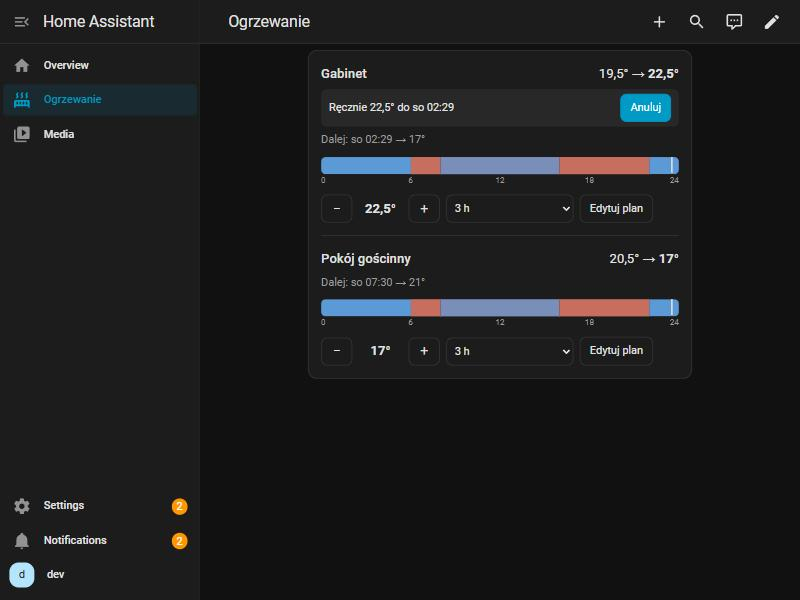

# Heating Plan

A Home Assistant integration that gives each room a weekly heating plan.
It writes the plan to Bosch Radiator Thermostat II (BTH-RA) devices through Zigbee2MQTT.
The thermostat then runs the plan itself, also when Home Assistant is not available.

Home Assistant adds:

- timed overrides that you can cancel with one click,
- exceptions from a calendar (for example a day off) and public holidays,
- the room temperature from a separate sensor,
- a Lovelace card with a plan editor.

> Status: in development. Do not use it yet.

## Requirements

- Home Assistant 2026.11 or later
- Zigbee2MQTT 2.14.3 or later (it gives the `weekly_schedule_<day>` entities)
- Bosch Radiator Thermostat II (BTH-RA)

## Installation

Home Assistant 2026.11 has the Marketplace (HACS) built in. The Marketplace installs a custom repository only from a GitHub release with a tag.

1. In the Marketplace, add `https://github.com/mikolajpiecuch/ha-heating-plan` as a custom repository of type "Integration".
2. Install "Heating Plan" (the latest release) and restart Home Assistant.
3. Go to Settings > Devices & services and add "Heating Plan".

## Lovelace card

The integration adds the card `custom:heating-plan-card`. Without `entity`, the card shows all rooms.

```yaml
type: custom:heating-plan-card
entity: climate.office_heating  # optional
```



## Development

- Tests: `pip install -r requirements_test.txt`, then `pytest`.
- A development Home Assistant with fake thermostats: `scripts/develop`, then `python dev/setup_demo.py`. Open http://localhost:8123 and log in as `dev` / `dev`.

## License

MIT
